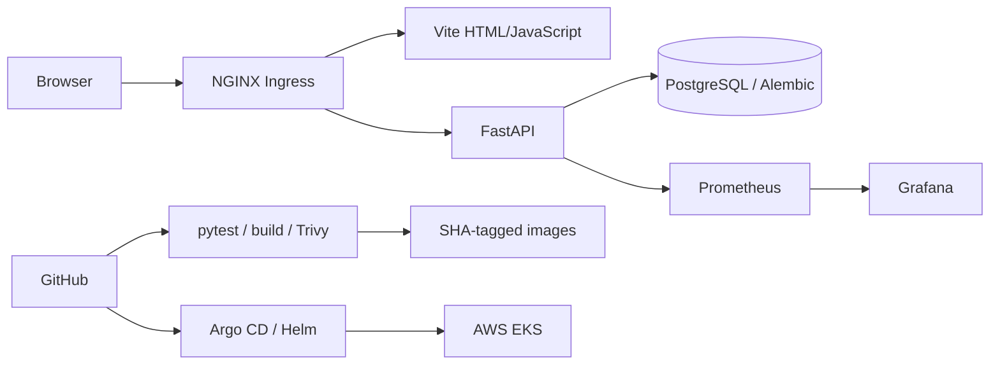

# devops-heros

My notes and homework for the DevOps course.

The [Session 21 Operations Notes capstone](final-devops-project/README.md) provides a responsive
frontend, FastAPI API and PostgreSQL storage, with pytest, Alembic migrations, Docker,
GitHub Actions, Helm, Ingress, HPA and Prometheus/Grafana.

**Capstone submission:** [slides and video folder](demo/) · [full rubric audit](final-devops-project/demo/RUBRIC-CHECKLIST.md).
The [student walkthrough](https://github.com/rajasurya-rjs/devops-heros/releases/download/capstone-walkthrough-2026-10-16/walkthrough.mp4) is uploaded to this repository’s release. The supplied deadline
has a weekday/date conflict; see [submission readiness](demo/README.md).

## Final capstone: Operations Notes

An original app for deployment checks and incident notes, with create/read/update/delete.
Full source, deployment instructions and evidence are in
[final-devops-project/README.md](final-devops-project/README.md).

**Tech stack:** Python, FastAPI, SQLAlchemy, Alembic, PostgreSQL, HTML/JavaScript, Vite,
NGINX, pytest, Docker Compose, GitHub Actions, Trivy, GHCR, Terraform, AWS EKS,
Kubernetes, Helm, Argo CD, Prometheus and Grafana.

**Local setup:** from `final-devops-project`, run `./scripts/local-up.sh` once to generate
an ignored private database password. Then `docker compose up --build` starts frontend,
backend and PostgreSQL. Open **http://localhost:13000**; port 3000 is reserved for Histomics.

**CI/CD:** `.github/workflows/three-tier-project.yml` runs on push to main. SQLite and
PostgreSQL tests plus frontend/source gates precede both image builds. Trivy fails on
HIGH/CRITICAL findings. Green images publish to GHCR with full Git SHA tags and are
verified with Helm in kind. Argo CD reconciles committed EKS Helm values; image promotion
uses an explicit tested SHA.

**Infrastructure:** Terraform creates a VPC, two public subnets, EKS and a managed worker
node group in **ap-southeast-2**. Only the `devops-homework` profile is used. Guard scripts
verify the correct project, ACTIVE FREE plan and available credits before cloud changes.
Credentials, state and private variables stay outside Git. Actual cleanup follows evaluation.

**Kubernetes/Helm:** namespace/bootstrap manifests are in `final-devops-project/k8s/` and
`kubernetes/`; the three-tier chart is in `helm/three-tier/`. Run the guarded
`kubernetes/deploy-capstone-aws.sh` and `gitops/argocd/install-eks.sh` with the private
homework kubeconfig. Both application Deployments run two replicas with ClusterIP Services.
Ingress routes `/` to frontend and `/api` to backend. See the full README for local steps.

**Observability:** `helm/observability/` and `monitoring/` install Prometheus and Grafana.
The backend exposes `/metrics`; Prometheus discovers each backend Pod and Grafana
provisions request-rate, errors, CPU and memory panels. `scripts/recording-up.sh` forwards
the real EKS Ingress, Prometheus, Grafana and Argo CD to localhost for the walkthrough.

**Presentation and limitations:** [12-slide PPT](demo/presentation.pptx),
[PDF](demo/presentation.pdf),
[recording guide](final-devops-project/demo/README.md) and
[rubric audit](final-devops-project/demo/RUBRIC-CHECKLIST.md). This private classroom app has
no login/public TLS, and the single EKS worker does not provide node redundancy. The
[student video](https://github.com/rajasurya-rjs/devops-heros/releases/download/capstone-walkthrough-2026-10-16/walkthrough.mp4) is available. Actual Terraform destroy proof remains pending after evaluation. The EKS Ingress uses localhost forwarding rather than a paid LoadBalancer.

**Name:** Rajasurya J
**Roll number:** 24BCS10086

## DevOps HomeWork
- Assignment doc: https://docs.google.com/document/d/1cjXFYf2Thm8cBEN-0C48B-v02cj3jGLd47lcO18prHE/edit

### My completed homework -> [`HOMEWORK.md`](HOMEWORK.md)

| Section | Link |
|---|---|
| Session 1&2: Linux Fundamentals | [README](session2-linux/Rajasurya-24BCS10086/README.md) |
| Session 3: Shell Scripting | [README](session3-shell-scripting/Rajasurya-24BCS10086/README.md) |
| Session 4: Networking | [README](session4-networking/Rajasurya-24BCS10086/README.md) |
| Session 5: Git and GitHub | [README](session5-git-github/Rajasurya-24BCS10086/README.md) |
| Session 6: Docker Fundamentals | [README](session6-docker/Rajasurya-24BCS10086/README.md) |
| Session 7: Docker Images | [README](session7-dockerfiles-images/Rajasurya-24BCS10086/README.md) |
| Session 8: Docker Networking | [README](session8-docker-networking-volume/Rajasurya-24BCS10086/README.md) |
| Session 9: Kubernetes Fundamentals | [README](session9-k8s/Rajasurya-24BCS10086/README.md) |
| Session 10: Kubernetes Pods, ReplicaSets & Deployments | [README](session10-k8s-core-objects/Rajasurya-24BCS10086/README.md) |
| Session 11: Kubernetes Networking & Services | [README](session-11-kubernetes-services/Rajasurya-24BCS10086/README.md) |
| Session 12: Kubernetes Ingress, ConfigMaps & Secrets | [README](session-12-ingress-configmaps-secrets/Rajasurya-24BCS10086/README.md) |
| Session 13: Kubernetes Storage, HPA & Probes | [README](session-13-storage-hpa-probes/Rajasurya-24BCS10086/README.md) |
| Session 14: Kubernetes Troubleshooting | [README](session-14-kubernetes-troubleshooting/Rajasurya-24BCS10086/README.md) |
| Session 15: Helm | [README](session-15-helm/Rajasurya-24BCS10086/README.md) |
| Session 16: CI/CD & GitHub Actions | [README](session-16-github-actions/Rajasurya-24BCS10086/README.md) |
| Session 17: Complete CI/CD & DevSecOps | [README](session-17-devsecops/Rajasurya-24BCS10086/README.md) |
| Session 18: Terraform & Infrastructure as Code | [README](session18-terraform-iac/Rajasurya-24BCS10086/README.md) |
| Session 19: Cloud & Terraform in Action | [README](session19-cloud-terraform/Rajasurya-24BCS10086/README.md) |
| Session 20: Monitoring, Observability & GitOps | [README](session20-monitoring-observability-gitops/Rajasurya-24BCS10086/README.md) |
| Session 21: Final DevOps Project & Troubleshooting | [README](final-devops-project/README.md) |

[Submission fields and direct README URLs](SUBMISSION.md).

## Class notes by session
- [session1 - DevOps engineer roadmap](session1-devops-engineer-roadmap/)
- [session2 - Linux](session2-linux/)
- [session3 - Shell scripting](session3-shell-scripting/)
- [session4 - Networking](session4-networking/)
- [session5 - Git & GitHub](session5-git-github/)
- [session6 - Docker](session6-docker/)
- [session7 - Dockerfiles & images](session7-dockerfiles-images/)
- [session8 - Docker networking & volumes](session8-docker-networking-volume/)
- [session9 - Kubernetes fundamentals](session9-k8s/)
- [session10 - Kubernetes core objects](session10-k8s-core-objects/)
- [session11 - Kubernetes services & networking](session-11-kubernetes-services/)
- [session12 - Ingress, ConfigMaps & Secrets](session-12-ingress-configmaps-secrets/)

## Submission link
- Section A: https://forms.gle/ydjAJcwxjpjBXgxB8
- Section B: https://forms.gle/pAuXQaokwVzhRzit6
