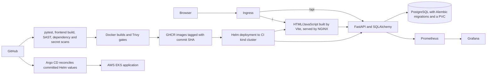

# Operations Notes — Session 21 Capstone

**Rajasurya J · 24BCS10086**

**Repository:** https://github.com/rajasurya-rjs/devops-heros

Operations Notes records deployment checks and incident fixes. Users can create, list,
read, edit and delete notes. The responsive HTML/JavaScript frontend uses a FastAPI
backend and PostgreSQL database. This is an original application domain, rather than a
copy of the TaskBoard reference application.

The project follows the [submission guidelines](https://github.com/Nency-Ravaliya/devsecops-python/blob/main/SUBMISSION.md)
and the [grading rubric](https://github.com/Nency-Ravaliya/devsecops-python/blob/main/GRADING.md).

## Architecture



## Source map

| Path | Purpose |
|---|---|
| [backend/app/](backend/app/) | FastAPI routes, schemas, SQLAlchemy models and connections |
| [backend/alembic/versions/](backend/alembic/versions/) | Versioned database migration |
| [backend/tests/](backend/tests/) | Isolated pytest API and migration tests |
| [frontend/](frontend/) | Responsive HTML/JavaScript, Vite build and multi-stage Dockerfile |
| [docker-compose.yml](docker-compose.yml) | Frontend, backend and PostgreSQL local stack |
| [helm/three-tier/](helm/three-tier/) | Two frontend replicas, backend HPA, database PVC and Ingress |
| [k8s/namespace.yaml](k8s/namespace.yaml) | Application namespace |
| [helm/observability/](helm/observability/) | Standalone Prometheus and Grafana Helm chart |
| [monitoring/values-local.yaml](monitoring/values-local.yaml) | Monitoring Helm values |
| [terraform/](terraform/) | Existing AWS VPC/EKS infrastructure code |
| [CI workflow](../.github/workflows/three-tier-project.yml) | Test, build, scan, SHA-tagged publication and kind deployment |

The earlier Python HTTP-server implementation remains in `application/` for completed
homework exercises. [README-previous.md](README-previous.md) preserves its original deployment
instructions, screenshots, logs and historical cloud results. The current three-tier FastAPI application was also deployed and verified on EKS on 13 October 2026; see [current evidence](evidence/completion/README.md).

## Local Docker setup

Requirements: Docker Desktop/Engine, Compose, Bash and OpenSSL. Run from `final-devops-project`:

```bash
./scripts/local-up.sh
```

The helper generates a random password in the Git-ignored `.env` file with mode 600,
then runs `docker compose up -d --build --wait`. No password is committed.
After that first setup, the standard command also works:

```bash
docker compose up --build
```

Open **http://localhost:13000**. The frontend proxies `/api`, `/health`, `/ready`, `/metrics`,
`/burn` and Swagger `/docs` to the backend. PostgreSQL is on an internal network and is not
published to the host. The two application images run without root. The backend runs
Alembic before starting Uvicorn. Backend replicas serialize PostgreSQL migrations with an advisory
lock, so concurrent backend startup does not race schema creation.

```bash
docker compose -p ops-notes-capstone ps
python3 kubernetes/verify-api.py http://127.0.0.1:13000
docker compose -p ops-notes-capstone exec database psql -U notes -d notes -c 'TABLE notes;'
docker compose -p ops-notes-capstone exec database psql -U notes -d notes -c 'TABLE alembic_version;'
```

Stop without deleting saved data: `docker compose -p ops-notes-capstone down`.
The database uses a named volume. Do not remove that volume unless its notes are disposable.
The earlier `docker/compose.yaml` entry point remains available on port 18082 with
`--env-file docker/.env` after generating that local password file as documented in the previous README.

## Backend and migrations

| Method | Endpoint | Purpose |
|---|---|---|
| GET | `/health` | Process health |
| GET | `/ready` | Database readiness, 503 when unavailable |
| GET | `/api/notes` | List notes |
| GET | `/api/notes/{id}` | Read one note |
| POST | `/api/notes` | Create a note, 201 |
| PUT | `/api/notes/{id}` | Update a note |
| DELETE | `/api/notes/{id}` | Delete a note |
| GET | `/api/config` | App version, database type and Secret-injection boolean |
| GET | `/metrics` | Prometheus counters, latency, CPU and memory metrics |
| GET | `/docs` | Interactive FastAPI Swagger documentation |

POST/PUT accept `{"text":"Deployment checked"}`. Text must contain 1–500 characters.
SQLAlchemy binds SQL values, and the frontend renders saved text using `textContent`.
The classroom application has no user login. `/api/config` never returns the Secret value.
The initial migration creates `notes` and tracks revision `0001_notes`. It can adopt the
compatible table from the earlier application while preserving saved rows. A regression
test verifies adoption and repeat migration. Destructive downgrade is deliberately disabled.

Run the backend directly from `backend` after installing its requirements:

```bash
python3 -m venv .venv
.venv/bin/pip install -r requirements-dev.txt
# For PostgreSQL, set DATABASE_URL to your private local connection URL.
.venv/bin/python -m app.migrate
.venv/bin/uvicorn app.main:app --host 127.0.0.1 --port 8080
```

Without a database URL, direct development uses a local SQLite `notes.db`; Compose and
Kubernetes always use PostgreSQL.

## Tests and frontend build

```bash
cd backend
.venv/bin/python -m pytest -v
cd ../frontend
npm ci
npm run build
```

`pytest.ini` sets the test directory and import path. Each SQLite test uses a fresh temporary
migrated database. PostgreSQL tests require the explicit `TEST_DATABASE_URL` variable and
refuse database names that do not end in `_test`. Production `DATABASE_URL`/`PGHOST` values
cannot select the pytest storage. CI creates a dedicated `notes_test` database.

The tests cover CRUD, invalid bodies, SQL-injection text, missing notes, readiness failure,
health, metrics, Swagger, Secret redaction and migration compatibility.

## CI/CD and security

The root workflow runs on every push to `main`, as well as relevant pull requests and
manual dispatches. Both database test runs and the Vite build must pass before image builds.
Bandit, pip-audit and Gitleaks provide separate source, dependency and secret gates.
Trivy scans both final application images and exits nonzero on any HIGH/CRITICAL finding,
including unfixed findings. Only successful gates permit GHCR publication.

Images use the full Git commit SHA. A kind cluster loads those exact images, deploys Helm,
checks two Ready replicas per application Deployment, exercises the API and queries
PostgreSQL. The backend ConfigMap receives the same SHA as `APP_VERSION`, and the API
verification asserts it. This proves which source revision was deployed in that CI run.
Pull requests build/test/deploy locally in the runner and do not publish images.

Trivy inspects the operating-system packages and application dependencies inside each
container image against its vulnerability database. Earlier frontend findings affected
`libexpat` and `pcre2`; the recorded fix upgraded those packages. A clean scan means the
scanner found no matching findings at the selected severities at scan time. It does not
prove that all possible vulnerabilities are absent.

[Successful current pipeline](https://github.com/rajasurya-rjs/devops-heros/actions/runs/38417521000)
includes 23 SQLite tests, 23 dedicated PostgreSQL tests, frontend build, source gates,
both Docker/Trivy jobs, GHCR publication and the kind Helm deployment. Both image tags are full 40-character SHAs.
Full-history secret scanning passes with seven exact reviewed exceptions for classroom
examples in Session 12; no broad ignore rules or history rewriting were used.
See [secret review](security/secret-scan.md).

## Local Kubernetes and Helm

Use the existing local `devops-completion` minikube profile. These commands do not target AWS:

```bash
kubectl config use-context devops-completion
minikube -p devops-completion start
minikube -p devops-completion addons enable ingress
minikube -p devops-completion addons enable metrics-server
minikube -p devops-completion image load ops-notes-frontend:local
minikube -p devops-completion image load ops-notes-backend:local
minikube -p devops-completion image load postgres:17-alpine
./kubernetes/deploy-three-tier.sh
kubectl get pods,deploy,svc,pvc,hpa,ingress -n project-three-tier
helm list -n project-three-tier
```

The helper applies `k8s/namespace.yaml`, creates random database/demo-token Secret values
when absent, and runs `helm upgrade --install`. The chart has at least two frontend replicas,
backend HPA with minimum two/maximum five replicas, ClusterIP Services, probes, resource
requests/limits, a PostgreSQL StatefulSet and a persistent volume claim.

Ingress routes `/` to frontend and `/api` directly to backend. Add `notes.project.local`
to your local hosts file using the IP from `minikube -p devops-completion ip`, then open
**http://notes.project.local**. Localhost port forwarding provides another verification path:

```bash
kubectl port-forward -n project-three-tier svc/frontend 18083:8080
# Another terminal:
python3 kubernetes/verify-api.py http://127.0.0.1:18083
python3 scripts/load-test.py http://127.0.0.1:18083 --seconds 60
kubectl get hpa -n project-three-tier --watch
```

HPA needs Metrics Server and can take time to react. A configured HPA alone is not evidence
of observed scaling. The rendered manifests in `kubernetes/three-tier.yaml` come from the chart.

## Monitoring from a fresh cluster

```bash
./monitoring/deploy-three-tier.sh
kubectl port-forward -n project-monitoring svc/prometheus 39091:9090
# Another terminal:
kubectl port-forward -n project-monitoring svc/grafana 33001:3000
```

The helper installs the observability Helm chart into `project-monitoring`; it does not
assume an older monitoring installation. Prometheus discovers each backend Pod in the
application namespace, so replica counters remain separate rather than alternating behind
a load-balanced Service. RBAC grants only Pod discovery in that namespace.
Grafana provisions the **Operations Notes - Three Tiers** dashboard. Its request/error rate
panels aggregate across Pods, while CPU and memory series identify each Pod.
Grafana's anonymous access is Viewer-only for this local classroom demo.

## Troubleshooting drill

The local-only [three-tier drill](kubernetes/troubleshooting/verify-three-tier.sh) captures
the live selector, image and readiness URL, then restores them with an exit trap. It
observes missing Service endpoints, an image-pull failure and a 404 readiness failure.
Run it only after the local Helm application is healthy, then repeat the API check.
Historical troubleshooting evidence is preserved in the previous README; this optional drill is outside the Session 21 grading requirements.

## Terraform and cloud evidence

Existing Terraform code and genuine AWS deployment logs remain preserved. The homework
profile is `devops-homework` and the selected Region is `ap-southeast-2`. The reference
brief's Region defaults do not override these project constraints.

Local code checks do not provision AWS:

```bash
terraform -chdir=terraform fmt -check
terraform -chdir=terraform validate
terraform -chdir=terraform test
```

The mock-provider test validates configuration. Genuine Terraform init, validation, original
26-resource provisioning and the 13 October non-empty plan/application are recorded in
[evidence](evidence/completion/README.md). The latest apply changed two access CIDRs in place,
without adding resources. VPC `vpc-01f95e9237ca7dae1` has two public subnets, and EKS
`rajasurya-final-devops` has the managed `homework-workers-free` node group.
The homework project was verified as ACTIVE FREE with remaining credits before cloud changes.
The scripts stop when that condition, project identity or kubeconfig cannot be verified.

Private Terraform inputs, state and kubeconfig stay outside Git. For another deployment,
copy `terraform/terraform.tfvars.example` to an ignored private file; never commit AWS keys.
The current private inputs and kubeconfig are under
`~/.local/share/devops-homework/capstone/` on this machine.

## EKS deployment and Argo CD

```bash
./kubernetes/deploy-capstone-aws.sh "$HOME/.local/share/devops-homework/capstone/kubeconfig"
./gitops/argocd/install-eks.sh "$HOME/.local/share/devops-homework/capstone/kubeconfig"
./scripts/recording-up.sh
python3 scripts/recording-browser.py
```

The EKS application uses two Ready frontend replicas and two Ready backend replicas,
PostgreSQL with a 1 GiB EBS PVC, and GHCR images tagged
`cdf8c14b34055fc15651fcde1533c129b7e957b2`. Argo CD v3.5.5 is self-hosted open-source software
tracking `main`, the `helm/three-tier` chart and `gitops/argocd/values-eks.yaml`.
Automatic sync and self-healing are enabled; automatic pruning is disabled to protect data.
Image promotion is explicit: after a green CI run, commit its full SHA in both image tags and
`appVersion`. A configuration Git revision can differ from the deployed image revision.

The previous Flux runtime is paused before Argo CD adopts the chart. The old application
and monitoring Deployments are scaled to zero, retaining their data and manifests.
Optional Argo CD controllers are scaled to zero to fit the existing single worker's Pod capacity.
The local minikube application uses its separate `values-local.yaml` with native ARM images.

The EKS Ingress controller uses a ClusterIP Service, avoiding a paid cloud load balancer.
`scripts/recording-browser.py` maps `notes.aws.project.local` to the localhost forwarding
port **28080**, which forwards to the actual NGINX Ingress controller. `/` and `/api` pass
real HTTP CRUD verification through its configured hostname. This is a forwarded Ingress
hostname, not a public LoadBalancer IP. Because there is no LoadBalancer status address,
only this Ingress has the documented Argo annotation `argocd.argoproj.io/ignore-healthcheck`;
its HTTP routes are verified separately. Deployment and PVC health checks remain active.
See [Argo CD's health documentation](https://argo-cd.readthedocs.io/en/stable/operator-manual/health/).

Recording endpoints: Ingress 28080, Prometheus 49091, Grafana 43001 and Argo CD 48080.
They bind to localhost. The browser helper signs into Argo CD with the initial password in
memory; it uses an isolated browser and does not read Chrome profile credentials.
Prometheus scrapes both EKS backend Pods and Grafana provisions the live application dashboard.

## Presentation, evidence and cleanup

The [12-slide PowerPoint](demo/presentation.pptx), [PDF](demo/presentation.pdf),
[recording guide](demo/README.md) and [Instructor’s grading requirements](https://github.com/Nency-Ravaliya/devsecops-python/blob/main/GRADING.md)
are linked here. Screenshots are indexed with their environment and provenance in
[evidence/completion/README.md](evidence/completion/README.md). Historical artifacts remain intact.

**[Student walkthrough — recorded and uploaded](https://github.com/rajasurya-rjs/devops-heros/releases/download/capstone-walkthrough-2026-10-16/walkthrough.mp4)** (33:47, original MP4).
The [video index](../demo/README.md) links the same-repository release asset and approximate chapters.
The live demo push passed [the complete capstone pipeline](https://github.com/rajasurya-rjs/devops-heros/actions/runs/38916498054).
The latest source verification also passed: [final green pipeline](https://github.com/rajasurya-rjs/devops-heros/actions/runs/38925353641).

**AWS cleanup completed on 16 October 2026 after recording.** See the
[actual completion log](evidence/completion/terraform-destroy-complete.txt) and [completion screenshot](images/terraform-destroy-complete.png).
The first attempt removed 26 of the original 28 resources before an expired request
interrupted Internet Gateway deletion. The successful retry removed the final two
resources and exited with status 0. The [first-attempt log](evidence/completion/terraform-destroy-first-attempt.txt)
is retained. Cloud URLs are no longer live; the video and dated screenshots preserve
the running deployment. Local Docker Compose remains runnable at localhost:13000.
The student still submits the public repository URL through the form; the agent does not submit it.

To review cleanup without removing resources:

```bash
./scripts/cleanup-aws.sh --plan
```

Only after the live demonstration/evaluation and after privately backing up any wanted notes:

```bash
./scripts/cleanup-aws.sh --execute 2>&1 | tee evidence/completion/terraform-destroy-complete.txt
```

This permanently removes the homework resources. The helper first removes application PVCs
while EBS CSI is running and then executes Terraform destroy. Capture the real completion
screenshot and verify no remaining homework resources or EBS volumes. The Google Form must
be submitted by the student; the agent does not submit it.

## Known limitations

This classroom app has no authentication or public TLS endpoint; keep its demo services
private. EKS has one worker, so two application replicas do not provide node redundancy.
Free-plan credit availability is checked before cloud operations, and no paid upgrade is
permitted. Test output includes one non-failing Starlette deprecation warning.
The walkthrough and actual cleanup completion evidence are available. The AWS deployment
has been deleted, so its browser URLs and kubeconfig no longer connect to a live cluster.
The local Compose stack can still be started independently. Student form submission is separate.
